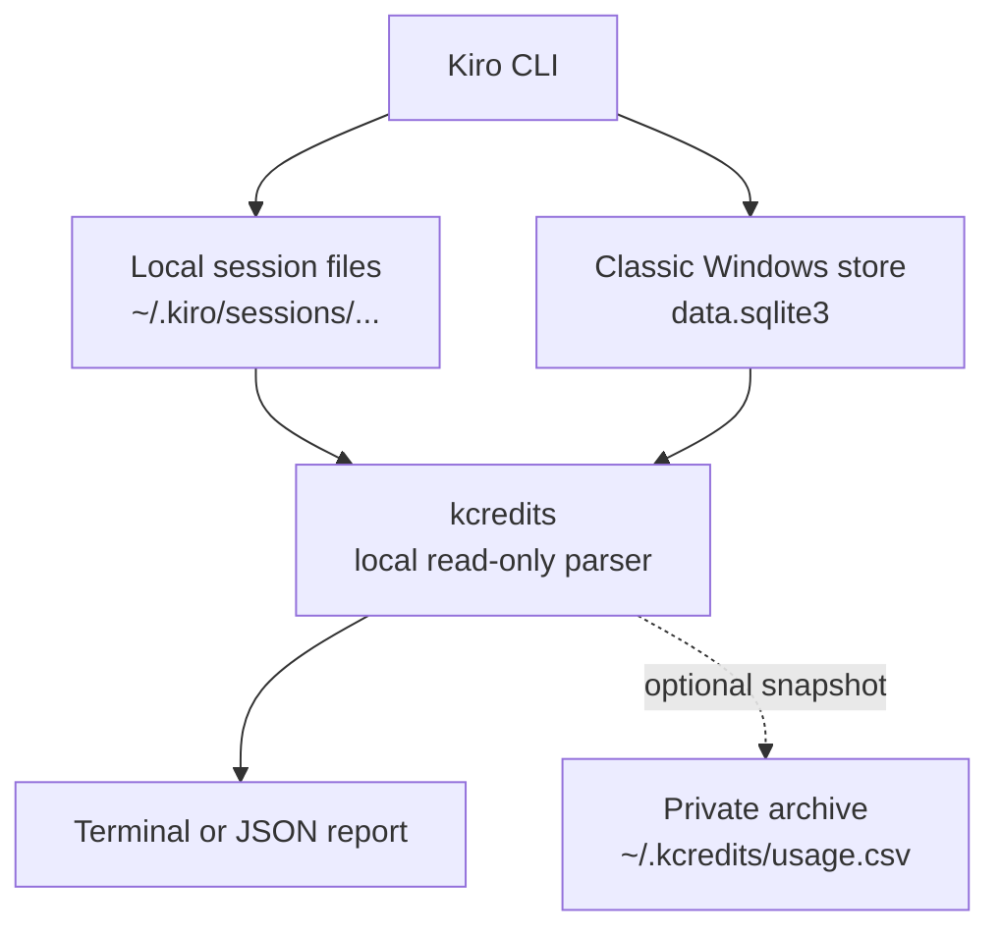

# kcredits

Privacy-first local credit usage reports for Kiro CLI.

`kcredits` reads credit metadata from the current user's local Kiro sessions and
groups it by project, model, and day. Reporting is read-only, uses no Kiro API
key, sends no telemetry, and has no third-party runtime dependency.

> **Community project:** this project is not affiliated with, maintained by, or
> endorsed by Kiro or Amazon Web Services.

[Bahasa Indonesia](docs/README.id.md)

## Why use it?

Kiro's built-in `/usage` command shows account usage and remaining credits.
`kcredits` complements it with a local historical view:

- usage across local projects;
- daily, weekly, 30-day, and all-time reports;
- breakdowns by model and day;
- JSON output for local scripts; and
- an optional private archive for durable local history.

## Privacy boundary

By design:

- `report` and `doctor` only read Kiro data under the current OS user;
- no command sends session data, paths, or credit metadata over the network;
- prompt and response content is never included in reports;
- optional archive commands write only to `~/.kcredits/usage.csv` unless
  `KCREDITS_DATA_DIR` is explicitly set; and
- real session files and archives must never be committed or attached to an
  issue.

Review [SECURITY.md](SECURITY.md) before sharing output or enabling snapshots.

## Requirements

- Kiro CLI, signed in, with at least one completed response;
- Python 3.12 or newer; and
- the same OS account that runs Kiro CLI.

Git is needed only when cloning the source.

## Quick start from source

### Windows PowerShell

```powershell
git clone https://github.com/firmansyahyunus/kiro-credits.git
Set-Location .\kiro-credits

py -3.12 .\kcredits.py doctor
py -3.12 .\kcredits.py report month
```

### macOS or Linux

```bash
git clone https://github.com/firmansyahyunus/kiro-credits.git
cd kiro-credits

python3 ./kcredits.py doctor
python3 ./kcredits.py report month
```

Package metadata is included so a release can later provide a standard
`kcredits` command:

```bash
python3 -m pip install .
kcredits report month
```

The package has not been published to PyPI yet. Installing from a reviewed
source checkout does not contact Kiro or add a runtime dependency.

## Commands

```text
kcredits doctor
kcredits report today
kcredits report week
kcredits report month
kcredits report all
kcredits report all --project example-project
kcredits report month --json
kcredits report month --json --safe-share
kcredits doctor --safe-share

# Optional private archive
kcredits snapshot
kcredits snapshot-all
kcredits migrate-archive
```

When running directly from the source, replace `kcredits` with
`python kcredits.py` on Windows or `python3 kcredits.py` on macOS/Linux.

Use `--safe-share` (or `--redact-paths`) before copying report or doctor output
into an issue, chat, screenshot, or log. It replaces local project and
filesystem paths with synthetic labels. Ordinary reports intentionally show
real local project paths.

## Example

```text
Kiro Credits - last 30 days
------------------------------------------------------------
Project                                     Turns    Credits
C:\work\example-project                        13     108.84
C:\work\sample-service                          4      27.58
------------------------------------------------------------
TOTAL                                          17     136.42

By model:
  example-model-a           14 turns      136.17 credits
  example-model-b            3 turns        0.25 credits
```

All names and values above are synthetic.

## How it works



The v3 session store is the primary source. The classic Windows SQLite store is
a secondary source when present. These are local implementation formats and may
change in future Kiro releases; compatibility fixes should use synthetic
fixtures only.

## Platform status

| Platform | Status |
|---|---|
| Windows | Locally validated with Python 3.12 |
| macOS | Automated CI prepared; real Kiro smoke test still required |
| Ubuntu/Linux | Automated CI prepared; real Kiro smoke test still required |

Do not claim full cross-platform validation until the public GitHub Actions
matrix and real Kiro smoke tests pass.

## Documentation

- [SETUP.md](SETUP.md) — platform-specific installation and troubleshooting
- [HOW-TO.md](HOW-TO.md) — reports, filters, JSON, and optional archives
- [SECURITY.md](SECURITY.md) — privacy boundary and vulnerability reporting
- [CONTRIBUTING.md](CONTRIBUTING.md) — safe contribution rules
- [PUBLIC-RELEASE-CHECKLIST.md](PUBLIC-RELEASE-CHECKLIST.md) — mandatory public-release gates

## Licence

[MIT](LICENSE)
